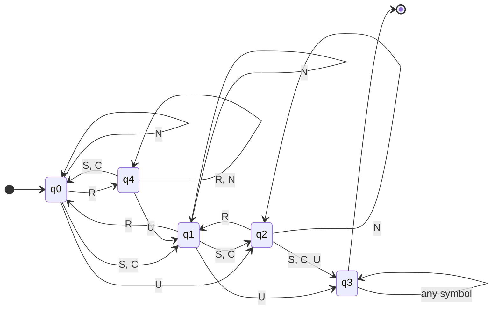

# f-kee_newss_detectionn_
Fake News / Misinformation Detection using Finite Automata (DFA)


A mini-project for Theory of Computation / Automata Theory (B.Tech Information Technology).
It shows how a Deterministic Finite Automaton (DFA) can be used to flag suspicious news headlines, and it
explains every decision the automaton makes (detected keywords, state transitions, final state) before it gives
the prediction Fake or Real.
> **Author:** YOUR NAME &nbsp;|&nbsp; **Roll No.:** YOUR ROLL NUMBER &nbsp;|&nbsp; **College / Department:** YOUR COLLEGE, B.Tech IT
> **Guide:** YOUR GUIDE'S NAME
---
Table of Contents
Project description
DFA explanation
Dataset
Folder structure
Installation steps
How to run in VS Code
How to run in Google Colab
Expected outputs
Sample inputs and outputs for testing
Sample screenshots
Code design
Limitations and future work
Publishing to GitHub
---
1. Project description
Misinformation headlines often share the same style: exaggerated wording ("SHOCKING", "miracle"),
conspiracy / clickbait phrases ("doctors hate", "mainstream media"), pressure to share ("forward this before it
is deleted") and a missing source. Real headlines usually attribute information to a source
("according to", "ministry", "study published").
This project converts a headline into a short string of symbols and feeds it to a DFA.
The state in which the automaton stops decides the result:
```
headline -> normalise -> tokenise -> map words to symbols (S, C, U, R, N)
         -> run the DFA -> final state -> Fake (accepting state) / Real
```
Key features
A real DFA with an explicit 5-tuple: states, alphabet, transition table, start state and accepting state
(the class even checks that the table is complete and deterministic).
Not just keyword counting: the order of the words matters (e.g. a credibility marker after a sensational
word cancels it, and the `FAKE` state is absorbing).
Dataset of 60 labelled headlines read with pandas, with accuracy / confusion-matrix evaluation.
Explainable output: detected keywords -> state transitions -> final state -> prediction.
Graceful handling of invalid input (empty text, numbers only, too short, too long, wrong data type, missing dataset).
Works as a command-line program (VS Code) and as a Google Colab notebook.
Auto-generated state diagram of the DFA.
---
2. DFA explanation
2.1 Formal definition
A DFA is a 5-tuple M = (Q, Σ, δ, q0, F):
Component	Meaning	In this project
Q	finite set of states	`{q0, q1, q2, q3, q4}`
Σ	input alphabet	`{S, C, U, R, N}`
δ	transition function `Q × Σ → Q` (exactly one next state for every pair)	table in 2.4
q0	start state	`q0`
F	set of accepting states	`{q3}`  (FAKE)
If, after reading the whole input, the DFA is in an accepting state the input is accepted.
Here, accepted = the headline is Fake.
2.2 Input alphabet
Every word (or phrase, using longest-match) of the headline becomes exactly one symbol:
Symbol	Category	Example words / phrases
S	Sensational / exaggerated wording	shocking, unbelievable, miracle, secret, exposed, 100%, guaranteed, instantly, `!`
C	Clickbait / conspiracy phrase	hoax, cover-up, illuminati, big pharma, mainstream media, doctors hate, you won't believe, wake up
U	Urgency / share-bait (strong signal)	urgent, share this, forward this, spread the word, before it's deleted
R	Credibility marker (source / attribution)	according to, officials, ministry, study, published, researchers, said
N	Neutral word (no signal)	every other word
2.3 States
State	Name	Meaning
`q0`	START / NEUTRAL	no net suspicious signal (start state)
`q1`	LOW SUSPICION	one suspicious signal
`q2`	HIGH SUSPICION	two signals - borderline, still classified Real
`q3`	FAKE (accepting, absorbing)	threshold reached; every symbol keeps the DFA in `q3`
`q4`	CREDIBLE	a credibility marker has been seen
2.4 Transition table (δ)
state \ symbol	S	C	U	R	N
q0 (start)	q1	q1	q2	q4	q0
q1	q2	q2	q3	q0	q1
q2	q3	q3	q3	q1	q2
q3 (accepting)	q3	q3	q3	q3	q3
q4	q0	q0	q1	q4	q4
Intuition: `S` and `C` move the automaton one step towards `q3`; `U` is stronger and moves it two steps;
`R` moves it one step back (or into `q4` from `q0`); `N` never changes the state (self-loop).
2.5 State diagram

(Double circle = accepting state. Red arrows lead into the FAKE state. Regenerate with
`python fake_news_detection.py --diagram images/dfa_diagram.png`.)
The same diagram as Mermaid code (GitHub renders it automatically):

2.6 Worked example
Headline: "Miracle weight loss pill guaranteed to work, doctors hate it"
Read	Symbol	Transition
miracle	S	q0 → q1
weight loss pill	N	q1 → q1
guaranteed	S	q1 → q2
to work	N	q2 → q2
doctors hate	C	q2 → q3
it	N	q3 → q3
The DFA ends in q3, which is an accepting state, so the prediction is Fake.
2.7 Why this is a DFA (and not just a keyword search)
There is one start state and a complete transition table: for every state and every symbol there is
exactly one next state (checked in `DFA.validate()`).
The result depends on the sequence of symbols, not only on how many keywords appear
(`R` before or after `S` leads to different paths).
The automaton has finite memory (5 states) and no stack or counter - exactly the power of a regular language.
---
3. Dataset
`dataset.csv` contains 60 hand-written headlines (30 Fake, 30 Real).
Column	Description
`headline`	the news headline text
`label`	`Fake` or `Real`
The file is read with `pandas.read_csv()` in `load_dataset()`, which also checks the column names and labels,
removes empty rows and duplicates.
> The headlines are synthetic examples written for teaching purposes; they are not taken from real news sites.
---
4. Folder structure
```
fake-news-dfa-detector/
|-- fake_news_detection.py      # main program: DFA, detection, evaluation, CLI
|-- fake_news_detection.ipynb   # Google Colab / Jupyter notebook (same logic, step by step)
|-- dataset.csv                 # 60 labelled headlines (Fake / Real)
|-- requirements.txt            # Python dependencies
|-- README.md                   # project documentation (this file)
|-- .gitignore                  # files Git should ignore
`-- images/
    |-- dfa_diagram.png         # generated DFA state diagram
    `-- (your screenshots go here)
```
---
5. Installation steps
Requirements: Python 3.8 or newer and `pip`.
```bash
# 1. Get the project (after you have pushed it to GitHub - see section 13)
git clone https://github.com/YOUR_GITHUB_USERNAME/fake-news-dfa-detector.git
cd fake-news-dfa-detector

# 2. (Recommended) create and activate a virtual environment
python -m venv venv
#   Windows (PowerShell / CMD):
venv\Scripts\activate
#   macOS / Linux:
source venv/bin/activate

# 3. Install the dependencies
pip install -r requirements.txt
```
> On macOS / Linux you may need to type `python3` and `pip3` instead of `python` and `pip`.
---
6. How to run in VS Code
Install Python and the Python extension (Microsoft) for VS Code.
`File -> Open Folder...` and choose the `fake-news-dfa-detector` folder.
Open the Command Palette (`Ctrl+Shift+P`) -> Python: Select Interpreter -> pick the `venv` interpreter
(or any Python 3.8+ with the packages installed).
Open a terminal in VS Code (Terminal -> New Terminal) and run:
```bash
python fake_news_detection.py
```
This prints the DFA definition, evaluates the dataset, and then starts interactive mode where you can type
headlines. Type `quit` to stop.
Other ways to run it
Command	What it does
`python fake_news_detection.py`	full run: DFA definition + dataset evaluation + interactive mode
`python fake_news_detection.py --headline "Your headline here"`	classify one headline and exit
`python fake_news_detection.py --demo`	classify the built-in sample headlines
`python fake_news_detection.py --no-interactive`	definition + evaluation only (no prompt)
`python fake_news_detection.py --verbose`	also list the neutral-word self-loop transitions
`python fake_news_detection.py --diagram images/dfa_diagram.png`	save the DFA state diagram
`python fake_news_detection.py --dataset other.csv`	use a different CSV file
`python fake_news_detection.py --help`	show all options
Running the notebook inside VS Code: install the Jupyter extension, open `fake_news_detection.ipynb`,
choose the kernel (top right) and click Run All (you may need `pip install ipykernel`).
---
7. How to run in Google Colab
Option A - directly from GitHub (easiest)
Push the project to GitHub (section 13).
Edit the badge link at the top of this README (replace `YOUR_GITHUB_USERNAME`) and click Open in Colab,
or go to https://colab.research.google.com -> File -> Open notebook -> GitHub tab -> paste your repository URL
-> select `fake_news_detection.ipynb`.
Click Runtime -> Run all.
The notebook is self-contained: if `dataset.csv` is not present on the Colab machine it re-creates it from a copy
embedded in the notebook, so no manual upload is needed.
Option B - upload the notebook
Open https://colab.research.google.com -> File -> Upload notebook -> choose `fake_news_detection.ipynb`.
Runtime -> Run all.
Option C - clone the full repository inside Colab
```python
!git clone https://github.com/YOUR_GITHUB_USERNAME/fake-news-dfa-detector.git
%cd fake-news-dfa-detector
!pip install -q -r requirements.txt
!python fake_news_detection.py --no-interactive
!python fake_news_detection.py --headline "SHOCKING secret cure exposed! Share this before it's deleted"
```
In the notebook, change the headline in the "Try your own headline" form cell, or run the last
interactive mode cell to type several headlines (type `quit` to stop).
---
8. Expected outputs
8.1 Dataset evaluation (`python fake_news_detection.py --no-interactive`)
```
========================================================================
DATASET EVALUATION
========================================================================
Total headlines : 60  (30 Fake, 30 Real)
Correct         : 60
Accuracy        : 100.00 %

Confusion matrix (rows = actual, columns = predicted):
predicted  Fake  Real
label
Fake         30     0
Real          0    30

Fake class -> precision: 1.00   recall: 1.00   F1-score: 1.00
========================================================================
```
> **Honest note:** the dataset is small and was written together with the keyword lexicon, so the 100 % score only shows
> that the DFA logic works as designed. It is **not** a claim about performance on real-world news
> (see [section 12](#12-limitations-and-future-work)).
8.2 A Fake headline
`python fake_news_detection.py --headline "SHOCKING secret cure exposed! Share this before it's deleted"`
```
========================================================================
HEADLINE: SHOCKING secret cure exposed! Share this before it's deleted
========================================================================
STEP 1 - Detected keywords
  1. "shocking"  ->  S  (Sensational / exaggerated wording)
  2. "secret"  ->  S  (Sensational / exaggerated wording)
  3. "exposed"  ->  S  (Sensational / exaggerated wording)
  4. "!"  ->  S  (Sensational / exaggerated wording)
  5. "share this"  ->  U  (Urgency / share-bait)
  6. "before its deleted"  ->  U  (Urgency / share-bait)

STEP 2 - DFA state transitions (start state = q0)
  [ 1] q0 --S--> q1    (read "shocking")
  [ 2] q1 --S--> q2    (read "secret")
  [ 4] q2 --S--> q3    (read "exposed")
  [ 5] q3 --S--> q3    (read "!")
  [ 6] q3 --U--> q3    (read "share this")
  [ 7] q3 --U--> q3    (read "before its deleted")
  ...  1 neutral word(s) caused self-loops (hidden; use verbose mode to show)

STEP 3 - Final DFA state
  Final state     : q3
  Meaning         : FAKE - suspicion threshold reached (accepting, absorbing)
  Accepting state : YES
------------------------------------------------------------------------
PREDICTION: FAKE   (DFA ended in accepting state q3)
========================================================================
```
8.3 A Real headline
`python fake_news_detection.py --headline "Government announces new metro line, officials said"`
```
========================================================================
HEADLINE: Government announces new metro line, officials said
========================================================================
STEP 1 - Detected keywords
  1. "announces"  ->  R  (Credibility marker (source / attribution))
  2. "officials"  ->  R  (Credibility marker (source / attribution))
  3. "said"  ->  R  (Credibility marker (source / attribution))

STEP 2 - DFA state transitions (start state = q0)
  [ 2] q0 --R--> q4    (read "announces")
  [ 6] q4 --R--> q4    (read "officials")
  [ 7] q4 --R--> q4    (read "said")
  ...  4 neutral word(s) caused self-loops (hidden; use verbose mode to show)

STEP 3 - Final DFA state
  Final state     : q4
  Meaning         : CREDIBLE - credibility marker seen
  Accepting state : NO
------------------------------------------------------------------------
PREDICTION: REAL   (DFA ended in non-accepting state q4)
========================================================================
```
(The number in `[ n]` is the position of the word in the headline; neutral words are hidden unless you use `--verbose`.)
8.4 Invalid input is handled gracefully
```
Enter a news headline:
[Invalid input] The headline is empty. Please type a news headline.

Enter a news headline: 12345 !!!
[Invalid input] The headline must contain English letters, not only digits or symbols.

Enter a news headline: Hi
[Invalid input] The headline is too short (1 word(s)). Please enter at least 3 words.
```
8.5 DFA state diagram
Created by `--diagram` or by the notebook (see section 2.5).
---
9. Sample inputs and outputs for testing
#	Input headline	Detected keywords	Path of states	Final state	Prediction
1	SHOCKING secret cure exposed! Share this before it's deleted	shocking, secret, exposed, !, share this, before its deleted	q0 → q1 → q2 → q3 → q3 → q3 → q3	q3	Fake
2	Miracle weight loss pill guaranteed to work, doctors hate it	miracle, guaranteed, doctors hate	q0 → q1 → q2 → q3	q3	Fake
3	You won't believe this one weird trick! Share this now	you wont believe, !, share this	q0 → q1 → q2 → q3	q3	Fake
4	Urgent! Forward this message to everyone or your account will be blocked	urgent, !, forward this	q0 → q2 → q3 → q3	q3	Fake
5	Government announces new metro line, officials said	announces, officials, said	q0 → q4 → q4 → q4	q4	Real
6	Researchers publish study on air pollution in Indian cities	researchers, study	q0 → q4 → q4	q4	Real
7	Local school wins state level football tournament	(none)	q0 (stays)	q0	Real
8	Shocking rise in onion prices worries shoppers, ministry reports	shocking, ministry, reports	q0 → q1 → q0 → q4	q4	Real (credibility marker cancels the sensational word)
9	Sources reveal that vaccines contain tracking chips, wake up and see the hidden truth	wake up, hidden truth	q0 → q1 → q2	q2	Real (borderline - a known miss, see limitations)
10	(empty)	-	-	-	`[Invalid input] The headline is empty.`
11	`12345 !!!`	-	-	-	`[Invalid input] ... must contain English letters`
12	`Hi`	-	-	-	`[Invalid input] ... too short`
Try them yourself:
```bash
python fake_news_detection.py --headline "Urgent! Forward this message to everyone or your account will be blocked"
python fake_news_detection.py --headline "Local school wins state level football tournament" --verbose
```
---
10. Sample screenshots
Take your own screenshots after running the project and save them in the `images/` folder with the file names below,
then remove the `<!--` and `-->` comment markers so that they appear on GitHub.
Screenshot	File name	What to capture
DFA state diagram	`images/dfa_diagram.png`	already included (see section 2.5)
VS Code - dataset evaluation	`images/vscode_evaluation.png`	terminal after `python fake_news_detection.py --no-interactive`
VS Code - Fake prediction	`images/vscode_fake_output.png`	terminal output for a Fake headline
VS Code - Real prediction	`images/vscode_real_output.png`	terminal output for a Real headline
Colab - full notebook run	`images/colab_run_all.png`	notebook after Runtime -> Run all
<!--
### VS Code


### Google Colab

---
11. Code design
`fake_news_detection.py` is organised in numbered sections (the notebook re-uses the same sections):
Section	Content	Main functions / classes
1	Imports	-
2	DFA data: alphabet, states, transition table, keyword lexicon	`TRANSITION_TABLE`, `LEXICON`
3	Text processing	`normalize_text`, `validate_headline`, `tokenize`, `InvalidHeadlineError`
4	DFA engine	`DFA` (`validate`, `step`, `run`, `accepts`), `build_news_dfa`, `transition_table`
5	Detection	`detect`, `Prediction`, `Transition`
6	Reporting	`format_dfa_definition`, `format_report`, `interactive_mode`
7	Dataset (pandas)	`load_dataset`, `evaluate_dataset`, `format_evaluation`
8	Diagram (matplotlib)	`draw_dfa_diagram`
9	Command line	`build_arg_parser`, `main`
Clean-coding choices: type hints and docstrings everywhere, constants instead of magic strings, a generic `DFA` class that
knows nothing about news (so it can be reused), immutable result objects (`dataclass(frozen=True)`), custom exception for
bad input, no global state, and `main()` returns an exit code.
---
12. Limitations and future work
Limitations - please read before presenting this project
A DFA has finite memory and does not understand meaning. It reacts to trigger words and their order only.
False negatives: a fake headline with few trigger words stays below the threshold (example 9 above, or
"Aliens landed in Salem yesterday" which contains no keyword at all).
False positives: a true but emotionally worded headline may be flagged.
The lexicon is hand-written and English only; the dataset is tiny and synthetic. The 100 % score on the sample
dataset is therefore not a measure of real-world accuracy.
Real fake-news detection needs NLP / machine learning and fact checking. This project demonstrates the
automata-theory concept, not a production detector.
Possible extensions
Larger lexicon and dataset; regex-based patterns (regular expressions are equivalent to finite automata).
Show an NFA first and convert it to a DFA (subset construction), or minimise the DFA.
Compare with a machine-learning baseline (TF-IDF + logistic regression).
A small web interface (Streamlit / Flask).
---
13. Publishing to GitHub
```bash
cd fake-news-dfa-detector
git init
git add .
git commit -m "Initial commit: Fake news detection using DFA"
git branch -M main
git remote add origin https://github.com/YOUR_GITHUB_USERNAME/fake-news-dfa-detector.git
git push -u origin main
```
(Create the empty repository `fake-news-dfa-detector` on https://github.com/new first - do not tick
"Add a README" there.)
---
License
Released under the MIT License - free to use for learning. Add a `LICENSE` file if your college requires one.
Acknowledgements
Concepts from Introduction to Automata Theory, Languages, and Computation (Hopcroft, Motwani, Ullman) and
your course notes on finite automata.
